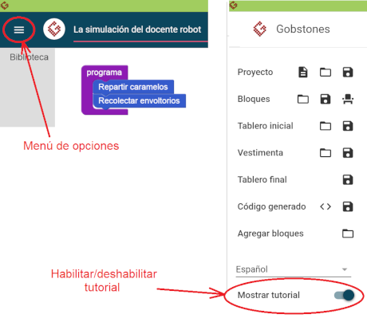

#Proyecto 1.1. La simulación de le docente robot

La idea de este proyecto es simplemente ver una simulación usando Gobstones. 
Para eso, tenés que ejecutar el programa que viene construido.
En la simulación se verá a une docente con sus estudiantes que irá visitando a 
cada une y dándole un caramelo; luego volverá al escritorio y repetirá la acción 
de visitarles pero retirando los papeles de caramelos.

Al finalizar la ejecución reflexionar sobre cómo los problemas del mundo real 
pueden simularse virtualmente. 
¿Cómo creés, en este caso, que se dieron las instrucciones a le docente? 
¡Mediante un programa!

> **Si no sabés como ejecutar, usá el tutorial**
>
> Si es la primera vez que entrás, el tutorial va a estar activado y se muestra 
> apenas cierres esta descripción. Pero si no está activado y querés verlo, podés 
> activarlo usando el menú de arriba a la izquierda.
>

>
>

[Enunciado en PDF][PDF]

[PDF]: https://raw.githubusercontent.com/gobstones/curso-InPr-UNQ/master/Proyectos/1.Descubrir%20Gobstones/1.1.La%20simulaci%C3%B3n%20del%20docente%20robot/assets/resources/description.pdf "Enunciado de 'La simulación del docente robot' en PDF"
