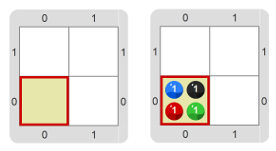
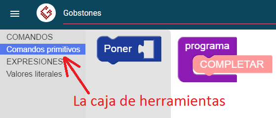

#Proyecto 2. Gobstones

¡Ahora es tu turno de usar Gobstones! 
Construí un programa que haga que la máquina al ejecutarlo ponga 4 bolitas, 
una de cada color, en la celda actual del tablero. 
O sea, el programa debe indicar que, comenzando con el tablero inicial de la 
izquierda, la máquina produzca el tablero final de la derecha.

Explorá el entorno para descubrir cómo agregar comandos primitivos a un programa 
y cómo ejecutar ese programa. Son varias cosas a descubrir. 
Estos descubrimientos te van a permitir hacer cosas muy interesantes. 
(Te damos una pista: ¡mirá la “caja de herramientas” que está a la izquierda!)

> **Para tener en cuenta**
>
> Los colores de las bolitas en Gobstones son `Azul`, `Negro`, `Rojo` y `Verde`. 
> Llamamos tablero  inicial al tablero en el que la máquina empieza a ejecutar el programa. 
> Y al tablero que la máquina deja cuando termina de ejecutar el programa lo llamamos tablero final. 
> La celda actual es la celda que el cabezal tiene justo debajo, y es la única en la que puede 
> realizar acciones en cada momento.

&nbsp;

> **Cuestión de argumento**
>
> El comando primitivo `Poner` tiene un _agujero_. 
> En ese agujero hay que poner un color. 
> Al valor que ponés en el agujero se lo llama **argumento**. 
> Por ejemplo, `Rojo` es el argumento en `Poner(Rojo)`.

[Enunciado en PDF][PDF]

[PDF]: https://raw.githubusercontent.com/gobstones/curso-InPr-UNQ/master/Proyectos/1.Descubrir%20Gobstones/2.Gobstones/assets/resources/description.pdf "Enunciado de 'Gobstones' en PDF"
