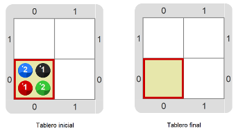

#Proyecto 4.1. Vaciar la celda

Tenés que construir un programa que haga que la celda quede vacía. 
Vas a precisar nuevos comandos primitivos. ¡A explorar! 

> **¿Quién hace las cosas?**
>
> El programa, realmente, no hace nada: es la máquina la que hace, cuando ejecuta el programa. 
> Pero es un poco más cómodo decir que es el programa el que hace, por lo que vamos a empezar a decirlo así.

[Enunciado en PDF][PDF]

[PDF]: https://raw.githubusercontent.com/gobstones/curso-InPr-UNQ/master/Proyectos/1.Descubrir%20Gobstones/4.1.Vaciar%20la%20celda/assets/resources/assets/resources/description.pdf "Enunciado de 'Vaciar la celda' en PDF"
