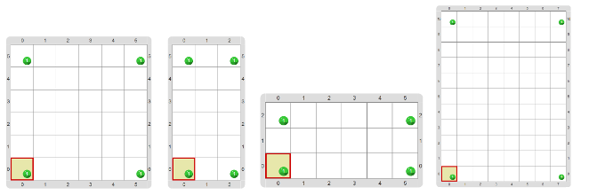

#Proyecto 5.1. Marquemos las puntas

Construí un programa que ponga 4 bolitas verdes una en cada esquina del tablero; 
es como si pusieses algo en cada rincón de una habitación. 
El desafío es construir **_un solo programa_**, pero ese programa tiene que 
funcionar **_en cualquier tablero inicial_** que se nos ocurra. 
Te mostramos algunos ejemplos de cómo deberían quedar diferentes tableros finales:
                

Investigá el entorno para descubrir algo que te permita conseguir este objetivo. 
¡Atención! Puede ser que a veces el cabezal no empiece posicionado en una esquina...

> **Probá, probá y probá**
>
> Asegurate de ejecutar el programa varias veces. 
> Cada vez que ejecutás este proyecto, el entorno usa un tablero inicial diferente. 
> Así podés ver que **_el mismo programa_** da siempre el resultado que esperás, sin 
> importar cuál es el tablero inicial. 
> Si querés elegir el tablero inicial vos, deshabilitá la opción de tablero aleatorio 
> (las flechitas al lado del botón de ejecución), y elegí el tablero que quieras 
> (con el menú de selección de tablero inicial, arriba a la izquierda del sector del tablero).
> 

> 
> 

&nbsp;

> **Recordatorio**
>
> Acordate que decimos que _“el programa pone bolitas”_, pero en realidad es la máquina que 
> lo ejecuta la que pone las bolitas. 
> De la misma forma, decimos _“el programa falló”_, cuando en realidad fue la ejecución del 
> programa lo que falló. 

[Enunciado en PDF][PDF]

[PDF]: https://raw.githubusercontent.com/gobstones/curso-InPr-UNQ/master/Proyectos/1.Descubrir%20Gobstones/5.1.Marquemos%20las%20puntas/assets/resources/description.pdf "Enunciado de 'Marquemos las puntas' en PDF"
