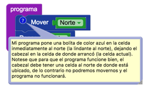

# 6.1. Haz lo que yo digo…
En muchas ocasiones puede ser súmamente útil agregar comentarios a tu programa que 
permitan saber a los demás (y a vos mismo, por si te olvidas luego) 
qué es lo que hace tu programa, y en qué condiciones esperás que funcione correctamente.

Un comentario puede agregarse dando click con el botón derecho sobre cualquier bloque, 
y seleccionando "agregar comentario". 
En ese comentario puedo agregar texto que no afecta en absoluto el programa, pero que me permite 
a mí y a otros, entender mejor que es lo que programé.

> **Siempre actualizado**
>
> Hay que asegurarse que el comentario refleje efectivamente lo
> que el programa hace, y por tanto, si cambio mi programa, debo
> recordar siempre actualizar los comentarios de forma acorde.

Un comentario aparece como un ícono azul con un signo de pregunta sobre el bloque, y 
puede verse dando click sobre dicho ícono.

> **Para pensar**
>
> En este caso
> - ¿El programa hace lo que se espera?
> - ¿El comentario es acorde al código?
> - ¿Cómo podría modificar mi programa para que lo haga?
> - ¿Cómo debería modificar el comentario para que coincida con el código?
> - ¿Tengo que cambiar el código o el programa? ¿Cuál es el que yo quería?

[Enunciado en PDF][PDF]

[PDF]: https://raw.githubusercontent.com/gobstones/curso-InPr-UNQ/master/Proyectos/1.Descubrir%20Gobstones/6.1.Haz%20lo%20que%20yo%20digo%E2%80%A6/assets/resources/description.pdf "Enunciado de 'Haz lo que yo digo…' en PDF"

