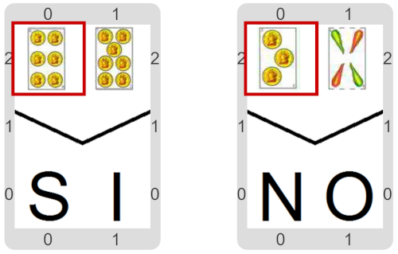

#Actividad 10.1. ¿Tengo envido?

Al igual que en una de las actividades anteriores, volvemos a tener 2 cartas en la mano.
El objetivo esta vez es hacer un programa que nos informe si esas cartas forman un envido o no (o sea, si son del mismo palo). 
Pero esta vez no contamos con las mismas primitivas que en actividades anteriores.
Parece que vas a tener que moverte para saber cuáles son los palos…
¿Cómo _recordar_ ambos?
¡A indagar!

> **Varias variables**
>
> Cada variable permite recordar un único dato por vez.
> Pero para recordar varios datos, puedo usar varias variables…

[Enunciado en PDF][PDF]

[PDF]: https://raw.githubusercontent.com/gobstones/curso-InPr-UNQ/master/Proyectos/10.Registros/10.1.Tengo%20envido/assets/resources/description.pdf "Enunciado de '¿Tengo envido?' en PDF"
