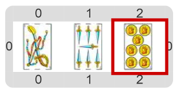

#Actividad 2.1. ¡Quiero retruco!

La idea de esta actividad es que armes una mano de truco con la que se pueda cantar _“¡quiero retruco!”_ 
Por ejemplo, una que tenga el ancho de espadas, el 7 de espadas y el 7 de oros. 
El escenario final debería quedar así:

**Atención:** la actividad te pide poner esas 3 cartas y nada más. No tenés que saber jugar al truco para completarla; 
solamente poné las 3 cartas para que el escenario final quede como el que se muestra.

> **¿Cómo hacer para decir en el programa cómo es una carta?**
>
> Seguro que hay operaciones para eso. ¡A indagar!

[Enunciado en PDF][PDF]

[PDF]: https://raw.githubusercontent.com/gobstones/curso-InPr-UNQ/master/Proyectos/10.Registros/2.1.Quiero%20retruco/assets/resources/description.pdf "Enunciado de '¡Quiero retruco!' en PDF"
