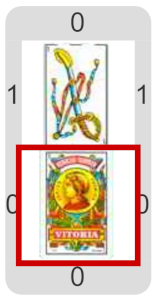

#Actividad 3. El alquimista

Esta actividad te invita a convertirte en un alquimista de la antigüedad, y tratar de trasmutar cualquier sustancia en oro.
Pero como es con cartas, es algo posible, y no solo un sueño para guiar las investigaciones.
La idea es que construyas un programa que para cualquier carta que aparezca, baje una carta con el mismo número, pero que sea
de oros.

> **Datos estructurados basados en otros**
>
> No todos los datos estructurados son fijos, constantes.
> A través del uso de expresiones, un programa puede construir datos que cambian según el escenario, además de 
> datos constantes.
> En este caso, eso se aplica al número de la carta a construir…

[Enunciado en PDF][PDF]

[PDF]: 
https://raw.githubusercontent.com/gobstones/curso-InPr-UNQ/master/Proyectos/10.Registros/3.El%20alquimista/assets/resources/description.pdf "Enunciado de 'El alquimista' en PDF"
