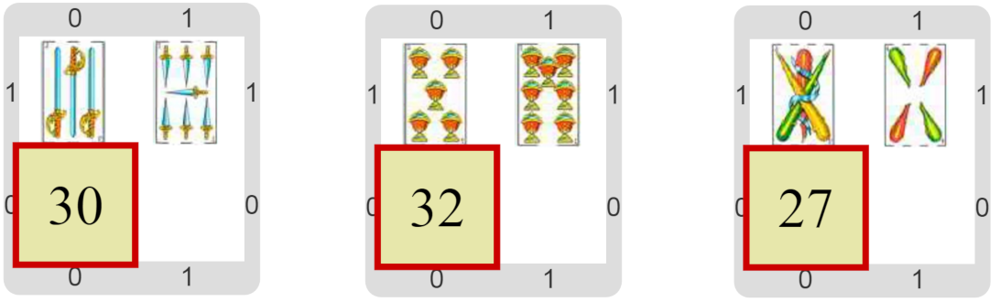

#Actividad 6. Calcular el envido simple

En esta actividad tenemos 2 cartas en la mano, y tenemos que calcular el valor del envido.

Recordemos que el envido se calcula de la siguiente manera: si ambas cartas tienen el mismo palo y no son figuras, sumamos 
los valores de las cartas más 20 puntos más. Si alguna de las cartas es una figura o si no tienen el mismo palo, las reglas 
son más complicadas. Por suerte, en esta actividad sabemos que no van a aparecer figuras, y que todas las cartas que aparecen 
tienen el mismo palo; por eso decimos que es un "envido simple".

Te mostramos algunos posibles escenarios finales, con el envido calculado correctamente.

> **¿Cómo hacemos para sumar los valores?**
>
> Seguro que hay operaciones para eso. ¡A indagar!

[Enunciado en PDF][PDF]

[PDF]: https://raw.githubusercontent.com/gobstones/curso-InPr-UNQ/master/Proyectos/10.Registros/6.Calcular%20el%20envido%20simple/assets/resources/description.pdf "Enunciado de 'Calcular el envido simple' en PDF"
