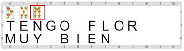
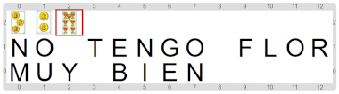

#Actividad 7.2. Es de…

Este ejercicio empieza parecido al anterior.
Tenemos que volver a ver si las cartas que hay en la mesa forman una "flor" en el juego del truco.
El problema es que esta vez no sabemos nada de ninguna de las cartas, y entonces no es tan simple como en 
la actividad anterior, ya que no sabemos de qué palo sería la flor.

Recordá que una flor se forma cuando las 3 cartas tienen el mismo palo. 
Entonces, para validarlo, el programa que viene a medio construir utiliza la estrategia de preguntar si 
la segunda y la tercera carta tienen el mismo palo que la primera.
Para eso utiliza una función llamada "`Es de`", que espera **dos** parámetros.
Tu trabajo es completar esta última función para que todo marche como debe.
Si todo sale como se espera, deberías obtener escenarios finales como los siguientes:

&nbsp;&nbsp;&nbsp;&nbsp;&nbsp;&nbsp;&nbsp;&nbsp;&nbsp;&nbsp;&nbsp;&nbsp;&nbsp;&nbsp;
&nbsp;&nbsp;&nbsp;&nbsp;&nbsp;&nbsp;&nbsp;&nbsp;&nbsp;&nbsp;&nbsp;&nbsp;&nbsp;&nbsp;

> **Más de un parámetro**
>
> Cuando una función o un procedimiento tienen más de un parámetro, tenemos que respetar la cantidad y el orden
> de argumentos al momento de usar esa operación. 
> También es importante respetar el tipo esperado de cada argumento porque si no la operación va a fallar.

[Enunciado en PDF][PDF]

[PDF]: 
https://raw.githubusercontent.com/gobstones/curso-InPr-UNQ/master/Proyectos/10.Registros/7.2.Es%20de%E2%80%A6/assets/resources/description.pdf "Enunciado de 'Es de…' en PDF"