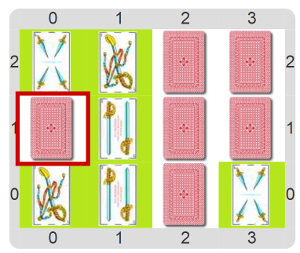

#Actividad 8. Memotest

En esta actividad ya viene (casi) construido un programa para jugar al Memotest. 
Sin embargo, por un descuido, falta una de las funciones: la que verifica si las dos cartas que se destaparon son 
iguales, "`las cartas son iguales`". Completá el programa para que se pueda jugar; el escenario en medio del juego 
debería verse como el siguiente.

> **Mirando las cartas**
>
> Para poder saber el `valor` y el `palo` de una carta, hay funciones primitivas especiales. ¡Buscalas!

[Enunciado en PDF][PDF]

[PDF]: https://raw.githubusercontent.com/gobstones/curso-InPr-UNQ/master/Proyectos/10.Registros/8.Memotest/assets/resources/description.pdf "Enunciado de 'Memotest' en PDF"
