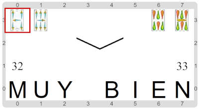

#Actividad 9.1. Envido simple con parámetros

Esta actividad trae un programa ya construido. Pero, otra vez, el programa tiene errores y tenés que corregirlo.

La idea de este programa es que transforma 2 grupos de 2 cartas en 2 números. 
Cada par de cartas forman un envido simple en el Truco (¿te acordás?: dos cartas del mismo palo y ninguna es una figura).
El objetivo es informar los valores de ambos envidos (¿y esto te lo acordás?: se suman los valores y se les suma 20).

Sin embargo, por culpa del error, no está funcionando bien. 
El escenario final debería ser el siguiente:

> **¡No dupliques código!**
>
> Una solución posible para este ejercicio es duplicar código.
> Pero eso es feo. El desafío es hacerlo usando las herramientas que aprendimos hace poco: los parámetros.

.

> **Entrada-Salida**
>
> Este programa es un ejemplo muy común de cierta forma de programas:
> tenemos ciertos datos iniciales, y queremos ciertos datos finales.
> A los datos iniciales los llamamos la _entrada_ del programa, y a los datos finales, la _salida_.
> Por eso a esta forma de hacer programas se la suele llamar _Entrada-Salida_.

[Enunciado en PDF][PDF]

[PDF]: 
https://raw.githubusercontent.com/gobstones/curso-InPr-UNQ/master/Proyectos/10.Registros/9.1.Envido%20simple%20con%20par%C3%A1metros/assets/resources/description.pdf "Enunciado de 'Envido simple con parámetros' en PDF"