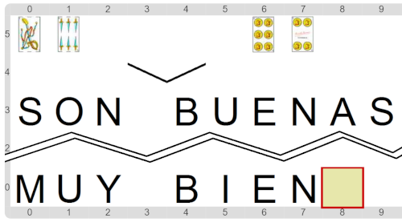

#Actividad 9.2. Son buenas

Una vez más, cuatro cartas: dos en tu mano, dos en la mano de la computadora.
Y una vez más, se trata de controlar el puntaje del envido.
Pero en esta ocasión hay que construir una función que establezca si tu envido pierde con el envido de la computadora:
tiene que dar verdadero si la computadora te gana, y falso si ganás vos.
Una observación: si ambos tienen el mismo puntaje, ganás vos, porque "sos mano" (o sea, jugás primero).

Igual que en la actividad pasada, sabemos que los dos pares de cartas tienen un envido simple (dos cartas del mismo palo,
y ninguna es una figura). Y acordate que el envido simple se calcula sumándole 20 a la suma los valores de las cartas.
La función que tenés que escribir se llama "**`son buenas`**" porque esa es la respuesta que se suele dar en el Truco cuando
las cartas del envido del otro le ganan a las tuyas.

Si el programa es correcto, el escenario final tiene que verse como el siguiente (fijate que 30 le gana a 27):

> **Más entrada-salida**
>
> Una vez más entran datos y salen datos.
> Las funciones con parámetros expresan esa idea de forma excelente.

[Enunciado en PDF][PDF]

[PDF]: 
https://raw.githubusercontent.com/gobstones/curso-InPr-UNQ/master/Proyectos/10.Registros/9.2.Son%20buenas/assets/resources/description.pdf "Enunciado de 'Son buenas' en PDF"