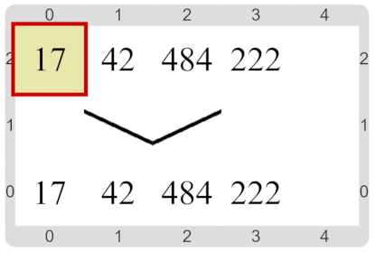

#Actividad 2. La lista contraataca

Nuevamente, tenés que descrubrir cuál es la lista. 
La idea es que uses el procedimiento para informar números para ir informando cada uno de los números de la lista en orden.
El tema es que ahora las operaciones primitivas disponibles son levemente distintas…

Un escenario final posible podría ser:

¡Probá con varios escenarios finales! Fijate que hay una forma de elegir otros…

> **Otra forma de obtener los elementos**
>
> Como viste, las funciones primitivas de listas no son las mismas que antes.
> La idea es que combines operaciones. 
> Indagá para saber qué hace cada una de ellas, y a partir de eso, pensá
> cuál es la combinación que te hace falta para cada elemento.
> Te damos un par de funciones empezadas, para guiarte.

[Enunciado en PDF][PDF]

[PDF]: 
https://raw.githubusercontent.com/gobstones/curso-InPr-UNQ/master/Proyectos/11.Listas/2.La%20lista%20contraataca/assets/resources/description.pdf "Enunciado de 'La lista contraataca' en PDF"