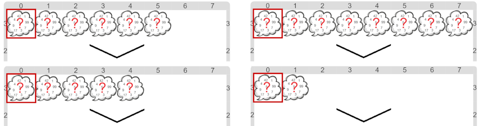

#Actividad 3. El regreso de la lista

Una vez más, tenés que descubrir cuál es la lista que aparece en el escenario. 
Pero si bien las primitivas de listas son las mismas que tuviste en la actividad anterior, 
como la lista no tiene siempre la misma longitud, vas a tener que buscar una manera
para lograrlo que no use una cantidad fija de comandos para informar un número.
Algunos escenarios iniciales posibles:

> **¿Cómo ir recorriendo la lista de a poco?**
>
> Una pista: para recorrer una lista, debés **recordar** los _elementos que aún no procesaste_.
> Y por supuesto, **repetir** el procesamiento para cada uno de los elementos.
> ¿Cuándo habría que terminar?

[Enunciado en PDF][PDF]

[PDF]: 
https://raw.githubusercontent.com/gobstones/curso-InPr-UNQ/master/Proyectos/11.Listas/3.El%20regreso%20de%20la%20lista/assets/resources/description.pdf "Enunciado de 'El regreso de la lista' en PDF"