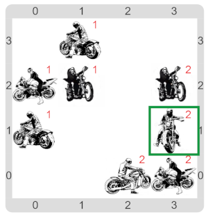

# 3. Convención de motoqueros

Convención de Motoqueros es una simulación del comportamiento de motoqueros a lo largo de una convención. 
En las convenciones, a los motoqueros les gusta interactuar con otros motoqueros y asociarse a clubes.

Convención de Motoqueros se puede modelar en Gobstones. 
Cada motoquero puede representarse con una celda del tablero. 
Una motoquero es vecino de otro si sus correspondientes celdas son lindantes en cualquiera de las 4 
direcciones ortogonales. 
La imagen de la izquierda de muestra una convención posible.

Durante una convención, se arman clubes, es decir, grupos de motoqueros activos que están conectados entre sí. 
Dos motoqueros se dicen conectados cuando hay una secuencia de motoqueros activos vecinos que los unen. Podemos además asignarles números a cada club, para diferenciarlos unos de otros y determinar cosas como qué grupo tiene más miembros, o cuál tiene menos. La imagen de la derecha de la Figura 1 muestra diversos grupos en la convención anterior, habiendo asignado un número a cada grupo.

1. Realizar la función `cantidadDeClubesEnLaConvención()` que determine la cantidad total de clubes de 
motoqueros que hay en la convención. 
Para ello se propone una estrategia _top-down_ para contar los clubes: asignar un número de club distinto 
y consecutivo a cada club, hasta no tener más clubes. 
El último número de club asignado debería permitir determinar la cantidad de clubes. 
Para esto se propone realizar las siguientes funciones y procedimientos (aunque pueden requerirse o ser 
útil algunos adicionales):
    * La función `hayMotoquerosActivosSinClub()` que indica si en la convención hay algún motoquero activo 
    que todavía no tenga un club.
    * El procedimiento `IrAMotoqueroActivoSinClub()` que asumiendo que hay un motoquero activo sin club, 
    deja el cabezal en el mismo.
    * El procedimiento `AsignarClub_AMotoquerosConectados(númeroDeClub)` que marca al motoquero actual y a 
    todos los motoqueros conectados a él como pertenecientes al club `númeroDeClub`.  
    Dichos motoqueros no deben tener un club previamente asignado. 
    Este problema es a su vez complejo, y se propone la siguiente estrategia para solucionarlo. 
        1. Paso 1, marcar al motoquero actual como perteneciente al club, y también a todos sus vecinos activos 
        que no tengan club asignado. 
        2. Paso 2, buscar en la convención algún motoquero activo sin club que tenga como vecino un motoquero 
        del club `númeroDeClub` e ir hasta el mismo.
        3. Repetir sucesivamente los pasos 1 y 2 hasta que no haya más motoqueros activos en la convención que 
        sean vecinos de otros con el club `númeroDeClub`.
    * El procedimiento `AsignarClub_AVecinos(númeroDeClub)` que marca todos los motoqueros vecinos al motoquero 
    actual que estén activos y sin club como pertenecientes al club número `númeroDeClub`.
    * La función `hayMotoqueroActivoYSinClubConVecinoEn_(númeroDeClub)` que indica si en la convención hay algún 
    motoquero activo sin club todavía que tenga de vecino otro motoquero activo que tenga por club `númeroDeClub`.
    * El procedimiento `IrHastaElMotoqueroActivoYSinClubConVecinoEn_(númeroDeClub)` que posiciona el cabezal sobre 
    un motoquero activo que no tenga club todavía y que tenga por vecino un motoquero en el club `númeroDeClub`.
2. Escribir la función `clubConMásMotoqueros()` que determina cuál es el club que tiene más motoqueros activos en 
la convención. Se propone como estrategia marcar primero los clubes, y luego contabilizar la cantidad de miembros 
de cada club, para luego saber cuál tiene más. 
De esto surgen los siguientes procedimientos y funciones (nuevamente, realizar adicionales puede resultar útil):
    * El procedimiento `AsignarClubATodosLosMotoquerosActivos()` que asigna un club a cada motoquero activo de la 
    convención.
    * El procedimiento `IrAAlgúnMotoqueroDelClub_(númeroDeClub)` que posiciona el cabezal en algún motoquero activo 
    miembro del club `númeroDeClub`.
    * La función `cantidadDeMiembrosDelClubActual()`  que determina la cantidad de miembros que posee el club del 
    cual el motoquero actual es miembro. El cabezal debe encontrarse sobre un motoquero que tenga un club asignado. 
    AYUDA: estructurarlo como un recorrido sobre todos los motoqueros.
