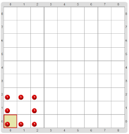

#Proyecto 1.1. Programo el cuadrado

Con los comandos que aprendimos se pueden hacer _“dibujos”_. 
Construí un programa para dibujar un cuadrado rojo de 3 bolitas de lado como muestra la figura.

> **Las bolitas pueden ser píxeles...**
>
> Si imaginamos al tablero de Gobstones como una hoja cuadriculada o una pantalla, podemos usar las 
> bolitas para dibujar sobre él. 
> Los comandos `Poner` y `Mover`, así, nos permiten trabajar como si tuviésemos lápices, dibujando 
> sobre el tablero. 

.

> **¡No te olvides de guardar!**
>
> Para llevar adelante una actividad tenés que abrir el proyecto primero. 
> No te olvides de que cuando el programa esté listo ¡tenés que guardarlo en la computadora así 
> podés volver a verlo más adelante! 
> Te sugerimos que le cambies el nombre, así no se mezclan tu solución con el proyecto original.

[Enunciado en PDF][PDF]

[PDF]: https://raw.githubusercontent.com/gobstones/curso-InPr-UNQ/master/Proyectos/2.Procedimientos/1.1.Programo%20el%20cuadrado/assets/resources/description.pdf "Enunciado de 'Programo el cuadrado' en PDF"
