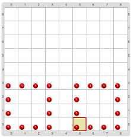

#Proyecto 1.2. Programo el cuadrado, programo el cuadrado

A) Construí un programa para dibujar dos cuadrados de color rojo, cada uno de tres bolitas 
   de lado, como muestra la figura. 
   ¿Te acordás de las actividades _“Lugar para los corners”_ y _“Programo el cuadrado”_? 
   Esta combina un poco de cada una. 

Prestá atención a la celda donde tiene que terminar el cabezal. 
Esto te puede ayudar porque los dos cuadrados se pueden dibujar con instrucciones muy parecidas, 
si los dos se empiezan a dibujar desde la misma esquina... 

> **El dato**
>
> Antes de dibujar el segundo cuadrado deberías usar un par de veces el comando primitivo `Mover(Oeste)`.

B) Luego de guardar el programa en tu computadora, tratá de hacer un cambio. 
   ¿Cómo habría que modificar al programa para que dibuje los cuadrados un poco más grandes? 
   El resultado tiene que ser como la siguiente imagen.

¿Fue muy difícil hacer el cambio? 
¿Te salió de una o tuviste que probar varias veces antes de conseguir que hiciera todo bien? 
¿Cuántos comandos primitivos tuviste que agregar y en qué lugares? 
¿Y si los cuadrados tuvieran que ocupar toda la altura del tablero, qué tan difícil sería hacer los cambios?
Acordate, al terminar, de volver a guardar tu solución con un nombre diferente al de antes.

[Enunciado en PDF][PDF]

[PDF]: https://raw.githubusercontent.com/gobstones/curso-InPr-UNQ/master/Proyectos/2.Procedimientos/1.2.Programo%20el%20cuadrado%2C%20programo%20el%20cuadrado/assets/resources/description.pdf "Enunciado de 'Programo el cuadrado, programo el cuadrado' en PDF"
