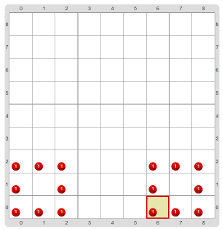
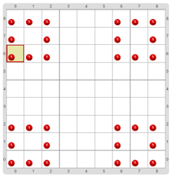

# Proyecto 3.1. Dos cuadrados, pero más fáciles 

A) La idea es que de nuevo dibujes dos cuadrados rojos, como en la actividad 
_“Programo el cuadrado, programo el cuadrado”_, pero en esta ocasión te pedimos que 
encuentres una forma de definir tus propios comandos; en el proyecto vas a encontrar una ayuda. 
Indagá cómo completar las partes que ya vienen empezadas, y cómo usarlas. 
El tablero final es igual que el que pedía la actividad mencionada. 
Al terminar con esta parte, fijate que hay una segunda parte.

> **El dato**
>
> El programa principal es la parte del código que la máquina busca para empezar a ejecutar. 
> Un programa siempre está formado por muchos procedimientos y un programa principal. 

.

> **Recordatorio**
>
> Un comando es la descripción de una acción. 
> Puede ser un comando primitivo o uno que haya sido definido mediante un procedimiento. 
> Y puesto que los comandos describen acciones, cuando definimos un comando nuevo, elegimos como 
> nombre algo que empieza con un verbo, al igual que los nombres de los comandos primitivos: dibujar, 
> poner, mover, etcétera. 

B) Después de guardar tu solución en la computadora, cambiá el programa para que dibuje cuatro 
   cuadrados, como en la figura. 
   La parte más complicada es la de mover el cabezal hasta donde hay que empezar a dibujar… 
   ¡pero para dibujar el cuadrado ya tenés tu propio comando!

> **Reutilizar es la clave**
>
> Reutilizar es aprovechar un programa o procedimiento ya hecho para no tener que hacerlo todo de nuevo, 
> y solamente hacerle pequeñas modificaciones para ajustarlo al nuevo problema.

[Enunciado en PDF][PDF]

[PDF]: https://raw.githubusercontent.com/gobstones/curso-InPr-UNQ/master/Proyectos/2.Procedimientos/1.3.Dos%20cuadrados%2C%20pero%20m%C3%A1s%20f%C3%A1ciles/assets/resources/description.pdf "Enunciado de 'Dos cuadrados, pero más fáciles' en PDF"
