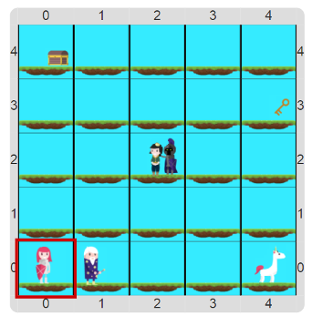

# Proyecto 4. La gran aventura del mar encantado

*“La mañana empezó mal para nuestra heroína: el Caballero Negro había secuestrado al Príncipe 
y ella aún no había arreglado las cosas con el Mago. 
Hacía dos días había discutido con el Mago, y le había sacado su sombrero mágico, escondiéndolo en un cofre. 
Pero el Mago era el único que podía darle la espada encantada que le iba a permitir vencer al Caballero Negro. 
La cosa no podía quedar así: tenía que salvar al Príncipe. 
Y cumplir juntos el sueño de pasear en Unicornio”*

Tenés que escribir un programa que cuente la historia de *“La gran aventura del mar encantado”*. 
La idea es ayudar a la protagonista a rescatar a su príncipe. 
Para hacerlo tiene que cumplir con una serie de tareas, en orden. 
Primero tiene que buscar la llave; cuando la tenga, la tiene que usar para abrir el cofre y sacar el 
sombrero mágico; luego le cambia el sombrero mágico al mago por la espada encantada, y con la espada va
a atacar al caballero, cumpliendo su misión de rescate; la aventura termina cuando la protagonista lleva 
al príncipe hasta el unicornio y escapan juntos.

Para contar la historia, lo mejor es escribir un procedimiento para cada parte. 
Para que no te preocupes por la representación, en el proyecto ya están hechos los procedimientos 
primitivos que te permiten hacer las acciones básicas y la vestimenta para que veas la historia con 
imágenes, y no con bolitas; vos solamente tenés que contar la historia. 
Tenés que tener cuidado: si la protagonista se cae o pasa por alguno de los lugares de las pruebas sin tener 
los elementos necesarios, el programa va a fallar. 

> **El dato**
>
> Si bien podés resolverlo sin procedimientos, lo interesante es que el programa resultante se lea como una 
> historia. Vos tenés que elegir bien los nombres de los procedimientos para que esto sea así. Por ejemplo, para la primera prueba podés hacer un procedimiento 'Ir a la llave', y otro 'Buscar la llave' que use al procedimiento anterior para ir a la llave y agarrarla.

Los procedimientos, además de ayudar a que los programas sean más cortos y fáciles de modificar, también 
hacen que el programa sea más fácil de entender, al permitir expresar la solución utilizando el vocabulario 
del problema. 
Si los procedimientos se eligen y nombran bien, cualquier persona que lea el programa podrá entender cuál 
fue la intención de quien lo programó, cuál es el problema y cómo se soluciona.

[Enunciado en PDF][PDF]

[PDF]: https://raw.githubusercontent.com/gobstones/curso-InPr-UNQ/master/Proyectos/2.Procedimientos/4.La%20gran%20aventura%20del%20mar%20encantado/assets/resources/description.pdf "Enunciado de 'La gran aventura del mar encantado' en PDF"
