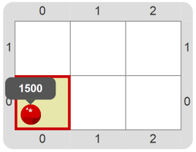

#Proyecto 1.2. La computadora repite por nosotros

Tratá de hacer un procedimiento que sirva para poner 1500 bolitas rojas. 
¿Habrá alguna herramienta en el entorno que nos haga el trabajo más fácil? 

Una vez que te salió el procedimiento para poner 1500 bolitas rojas usando un único comando, 
probá hacer de nuevo los procedimientos de la actividad anterior, cada uno de ellos con uno o dos 
bloques cada uno.

[Enunciado en PDF][PDF]

[PDF]: https://raw.githubusercontent.com/gobstones/curso-InPr-UNQ/master/Proyectos/3.Repetici%C3%B3n%20simple/1.2.La%20computadora%20repite%20por%20nosotros/assets/resources/description.pdf "Enunciado de 'La computadora repite por nosotros' en PDF"
