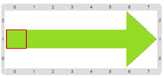

#Proyecto 3. Siga la flecha

Completá los procedimientos y el programa para dibujar una flecha como la de la figura: 
consiste en una línea de 7 celdas con bolitas verdes hacia el Este, que culmina en una punta 
compuesta por 3 celdas con 2, 3 y 4 bolitas verdes. 
El cabezal comienza en el inicio de la flecha y debe quedar en esa misma posición al 
finalizar la ejecución. 
En las imágenes se puede observar cómo debe quedar el tablero final, con y sin vestimenta.

  

La idea es que utilices tanto procedimientos como repeticiones simples. 
Fijate que para dibujar el tubo de la flecha, que también es llamado astil, vas a necesitar 
repetir una acción que se compone de dos comandos en lugar de uno solo. 
Y para dibujar la punta, también vas a tener que repetir una acción para poder poner muchas bolitas. 
Finalmente, ¡no te olvides de que al terminar de dibujar tenés que hacer que el cabezal vuelva a su 
posición inicial! Y eso se puede hacer moviéndolo muchas veces, o también yendo directamente al borde… 

[Enunciado en PDF][PDF]

[PDF]: https://raw.githubusercontent.com/gobstones/curso-InPr-UNQ/master/Proyectos/3.Repetici%C3%B3n%20simple/3.Siga%20la%20flecha/assets/resources/description.pdf "Enunciado de 'Siga la flecha' en PDF"
