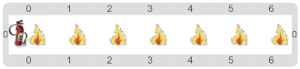

#Proyecto 4. Candela, me quemo

¡Se prende fuego el tablero! 
Valiéndote del procedimiento primitivo "`Usar matafuego`" escribí un procedimiento que apague el incendio 
del tablero que se ve a continuación:

¿Cuántas veces vas a tener que repetir la acción? 
Fijate que hay siete focos de incendio, pero no hay que moverse tantas veces…

[Enunciado en PDF][PDF]

[PDF]: https://raw.githubusercontent.com/gobstones/curso-InPr-UNQ/master/Proyectos/3.Repetici%C3%B3n%20simple/4.Candela%2C%20me%20quemo/assets/resources/description.pdf "Enunciado de 'Candela, me quemo' en PDF"
