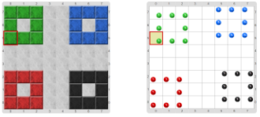

#Proyecto 1.1. Tablero de ludo, toma 1

Completá el programa para que dibuje cuatro cuadrados, uno en cada esquina, y cada uno de diferente color. El tablero final debería ser (con y sin vestimenta):

Para que no te olvides de dividir en subtareas y representar las mismas con procedimientos, te damos algunos procedimientos ya hechos, y otros empezados para que los completes.

[Enunciado en PDF][PDF]

[PDF]: http://raw.githubusercontent.com/gobstones/curso-InPr-UNQ/master/Proyectos/4.Par%C3%A1metros/1.1.Tablero%20de%20Ludo%2C%20toma%201/assets/resources/description.pdf "Enunciado de 'Tablero de ludo, toma 1' en PDF"
