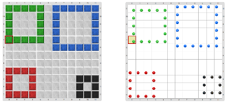

#Proyecto 2.2. Ludo loco, toma 2

Completá el programa para lograr el mismo tablero que en la actividad _“Ludo loco, toma 1”_, o sea, el siguiente tablero 
(mostrado con y sin vestimenta): 

La diferencia es que esta vez solamente vas a poder definir un único procedimiento para dibujar cuadrados, pero con más de un parámetro.

> **En orden**
>
> Acordate que pasar argumentos es una forma de indicarle a un comando con qué datos queremos que trabaje, 
> y tené en cuenta que la cantidad y orden de los argumentos debe coincidir con la cantidad y orden de los parámetros.

Podés dibujar cuadrados de cualquier color y cualquier tamaño con un único procedimiento para dibujar cuadrados. 
Probá otras combinaciones de tamaños y colores; tené en cuenta que para eso también vas a tener que modificar los procedimientos 
de posicionamiento: fijate que tendrías que cambiar los argumentos que se utilizan en cada uno de ellos. 
¿Cuántos procedimientos harían falta si el color no estuviese parametrizado pero la longitud sí?
        
[Enunciado en PDF][PDF]

[PDF]: https://raw.githubusercontent.com/gobstones/curso-InPr-UNQ/master/Proyectos/4.Par%C3%A1metros/2.2.Ludo%20loco,%20toma%202/assets/resources/description.pdf "Enunciado de 'Ludo loco, toma 2' en PDF"
