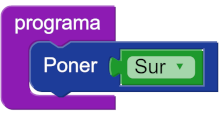

#Proyecto 1.1. No encuentro bolitas de color Sur

¿Qué hará el cabezal si le damos como instrucción `Poner(Sur)`? 
Puesto que el comando `Poner` espera un dato como argumento y `Sur` es un dato, podemos intentar hacer esa combinación. 
¿Tiene sentido? ¿Qué va a pasar? Construí un programa que haga exactamente eso y probalo. 
Reflexioná sobre lo que sucedió y tratá de explicarlo.

[Enunciado en PDF][PDF]

[PDF]: https://raw.githubusercontent.com/gobstones/curso-InPr-UNQ/master/Proyectos/4.Expresiones%20y%20tipos/1.1.No%20encuentro%20bolitas%20de%20color%20Sur/assets/resources/description.pdf "Enunciado de 'No encuentro bolitas de color Sur' en PDF"
