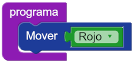

#Proyecto 1.2. ¿Para dónde queda Rojo?

Antes de este ejercicio deberías hacer _“No encuentro bolitas de color Sur”_. 
Si ya hiciste ese, ahora tenés que tratar de pensar qué va a pasar si el programa intenta hacer `Mover(Rojo)`. 
¡Atención! Tenés que anotar lo que creés que va a pasar antes de que lo ejecutes.
 
¿Ya terminaste de anotar tus suposiciones? 
Ahora sí, ejecutá el programa de este proyecto. 
¿Pasó lo que escribiste? ¿Qué fue lo que sucedió? 
¿Cuál es el tipo de datos de los argumentos que espera el comando `Mover`? 

[Enunciado en PDF][PDF]

[PDF]: https://raw.githubusercontent.com/gobstones/curso-InPr-UNQ/master/Proyectos/4.Expresiones%20y%20tipos/1.2.Para%20d%C3%B3nde%20queda%20Rojo/assets/resources/description.pdf "Enunciado de '¿Para dónde queda Rojo?' en PDF"
