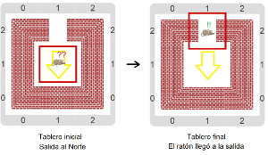
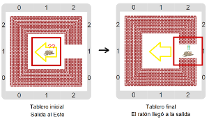
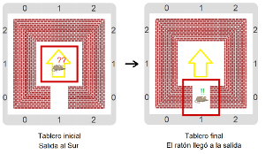

#Proyecto 3.2. La flecha enloqueció

Otra vez el ratón está atrapado en una jaula y necesita ayuda para encontrar la salida. 
Y otra vez tenés que construir un procedimiento `AyudarAlRatonASalir` que ayude al ratón a lograrlo. 
Pero podés descubrir un problema mirando los tableros iniciales del proyecto: la flecha que 
tiene que apuntar a la salida, ¡enloqueció! 
En lugar de apuntar a la salida, apunta para el otro lado, hacia la _dirección opuesta_. 
Tenés que hacer un programa similar al del proyecto anterior, pero ahora para ir para el otro lado: 
en cada caso, hay que ir en la dirección opuesta a la que indica la flecha. 
¡Volvé a explorar el entorno de Gobstones a ver si encontrás la herramienta que hace falta!
Te mostramos algunos tableros iniciales, y sus correspondientes tableros finales.
 

&nbsp;&nbsp;&nbsp;&nbsp;&nbsp;&nbsp;&nbsp;&nbsp;&nbsp;&nbsp;&nbsp;&nbsp;&nbsp;&nbsp;&nbsp;&nbsp;&nbsp;&nbsp;&nbsp;&nbsp;

&nbsp;&nbsp;&nbsp;&nbsp;&nbsp;&nbsp;&nbsp;&nbsp;&nbsp;&nbsp;&nbsp;&nbsp;&nbsp;&nbsp;&nbsp;&nbsp;&nbsp;&nbsp;&nbsp;&nbsp;
 

[Enunciado en PDF][PDF]

[PDF]: https://raw.githubusercontent.com/gobstones/curso-InPr-UNQ/master/Proyectos/4.Expresiones%20y%20tipos/3.2.La%20flecha%20enloqueci%C3%B3/assets/resources/description.pdf "Enunciado de 'La flecha enloqueció' en PDF"
