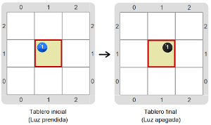
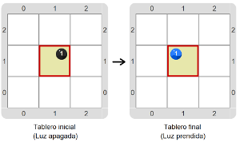

#Proyecto 1. Apagar la luz, o prenderla

En este proyecto tenés que construir y probar un procedimiento "`Simular interruptor de luz`" que funcione 
como un interruptor de luz; o sea, prender la luz si está apagada y apagarla si está prendida. 
Para representar una luz apagada vamos a usar una bolita negra, y para representar una luz prendida vamos 
a usar una bolita azul. 
Entonces, los tableros iniciales y sus correspondientes tableros finales pueden ser los siguientes:

&nbsp;&nbsp;&nbsp;&nbsp;&nbsp;&nbsp;&nbsp;&nbsp;&nbsp;&nbsp;&nbsp;&nbsp;&nbsp;&nbsp;&nbsp;&nbsp;&nbsp;&nbsp;&nbsp;&nbsp;

Nuevamente tenemos más de un tablero inicial diferente, y el mismo programa debe funcionar en los dos, 
aunque solo en los que la celda inicial tenga una bolita azul o una negra y nada más. 
Pero, ¿cómo hacer para saber si "`Prender la luz`" o "`Apagar la luz`"? 
Una vez más, tenés que explorar el entorno para encontrar las herramientas que hacen falta.

> **Ayuda**
>
>Para ayudarte en la búsqueda, te puede servir el siguiente diálogo:
> - ¿Cuándo decimos que la luz está prendida? 
> - &nbsp;&nbsp; Cuando hay una bolita de color azul.
> - Y _**si**_ hay una bolita azul, ¿_**entonces**_ qué hay que hacer?
> - &nbsp;&nbsp; Apagar la luz.
> - ¿Cómo se apaga la luz?
> - &nbsp;&nbsp; Sacando la bolita azul, y poniendo una negra.
> - ¿Y _**si no**_ hay una bolita azul?
> - &nbsp;&nbsp; Hay que prender la luz, porque si no hay bolita azul, entonces hay bolita negra, 
>   y eso quiere decir que la luz está apagada.
>
>¡No te olvides de definir procedimientos para las subtareas!

[Enunciado en PDF][PDF]

[PDF]: https://raw.githubusercontent.com/gobstones/curso-InPr-UNQ/master/Proyectos/6.Alternativa%20condicional/1.Apagar%20la%20luz%2C%20o%20prenderla/assets/resources/description.pdf "Enunciado de 'Apagar la luz, o prenderla' en PDF"

