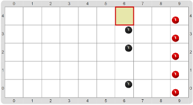
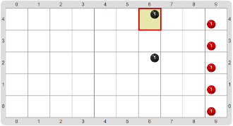
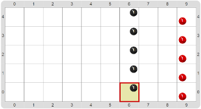

#Proyecto 4. No, no y no

Mirá el código que ya viene hecho; tenés que completarlo para ayudar al entrenador de fútbol a 
terminar de armar la línea de pelotas para que el Beto pueda entrenar. 
La idea es que el entrenador recorre la línea de pelotas y en cada lugar, pone una pelota solamente 
si _no_ hay una; si ya hay una pelota, no hace nada. 
Vas a tener que definir el procedimiento que falta y completar el programa principal. 
Como ayuda, te damos el procedimiento primitivo `Agregar pelota`, la función primitiva `hay pelota` y 
uno de los procedimientos que resuelven el problema ya definido.
Te mostramos algunos tableros iniciales posibles:

&nbsp;&nbsp;&nbsp;&nbsp;&nbsp;&nbsp;&nbsp;&nbsp;&nbsp;&nbsp;&nbsp;&nbsp;&nbsp;&nbsp;&nbsp;&nbsp;&nbsp;&nbsp;&nbsp;&nbsp;&nbsp;&nbsp;&nbsp;&nbsp;&nbsp;&nbsp;&nbsp;

                 
y también el tablero final para todos los casos:

Al tratar de definir `Agregar pelota si hace falta`, ¿qué es lo que hay que hacer? 
¡Ojo! 
Si agregás una pelota donde ya había una… ¡BOOM! 
Lo más importante que tenés que hacer es, entonces, decidir la condición para ver si agregar o no: 
vas a necesitar un operador nuevo; buscá en la caja de herramientas. 
Acordate: solamente tenés que agregar si _no_ hay pelota.

> **Para tener en cuenta**
>
> Fijate que el procedimiento `Completar la fila de pelotas` está hecho con una repetición, y 
> considera al caso de borde, es decir, el último caso que consideramos por separado por ser 
> levemente diferente, tal cual hiciste vos en la actividad _“Candela, ¡me quemo!”_. 
> Es importante que te acuerdes de estos detalles cuando hagas todo el programa por tu cuenta.

[Enunciado en PDF][PDF]

[PDF]: https://raw.githubusercontent.com/gobstones/curso-InPr-UNQ/master/Proyectos/6.Alternativa%20condicional/4.No%2C%20no%20y%20no/assets/resources/description.pdf "Enunciado de 'No, no y no' en PDF"

