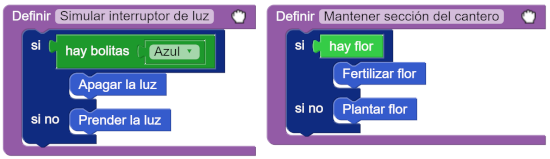

#Proyecto 1.1. La luz está prendida vs. hay bolitas: mi elección es clara

Compará los procedimientos que vienen hechos: `Simular interruptor de luz` y `Mantener sección del cantero`. 
Después de que encuentres en qué se diferencian, tenemos un desafío. 
Podés ver los dos procedimientos en la siguiente imagen:

           
Los dos procedimientos están hechos a partir de una alternativa condicional, y en los dos se usan procedimientos 
con buenos nombres. 
Pero, ¿qué pasa con la condición? 
El desafío: conseguí que `Simular interruptor de luz` sea tan fácil de leer y entender como `Mantener sección del cantero`. 
Para lograrlo, vas a tener que utilizar una herramienta nueva. 
Ya sabés dónde buscar, ¿no?

> **Idea**
>
> Recordá que para lograr que un comando sea más fácil de leer podés definir un procedimiento y darle un nombre que 
> hable de lo que ese comando representa. 
> ¿Podremos hacer lo mismo con las expresiones?     

[Enunciado en PDF][PDF]

[PDF]: https://raw.githubusercontent.com/gobstones/curso-InPr-UNQ/master/Proyectos/7.Funciones/1.1.Mi%20elecci%C3%B3n%20es%20clara/assets/resources/description.pdf "Enunciado de 'Mi elección es clara' en PDF"

