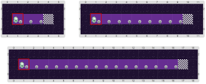

#Proyecto 1.1. Super Lucho 1

Vas a tener que ayudar a Lucho otra vez, como siempre, a prender todas las luces. 
Fijate que hay luces apagadas en todas las posiciones de la fila donde está Lucho. 
El problema es que no sabemos cuántas luces hay; lo que sí sabemos que la fila termina 
en una meta, como la de las carreras de autos. 
Algunos de los tableros iniciales son:

Si no se te ocurre cómo hacer, pensá que Lucho debe **repetir** la tarea de encender una 
luz **hasta que** llegue a la meta. 
Vas a tener que buscar una herramienta nueva…

[Enunciado en PDF][PDF]

[PDF]: https://raw.githubusercontent.com/gobstones/curso-InPr-UNQ/master/Proyectos/8.Repetici%C3%B3n%20condicional/1.1.Super%20Lucho%201/assets/resources/description.pdf "Enunciado de 'Super Lucho 1' en PDF"

