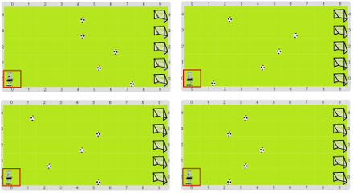

#Proyecto 3. Más entrenamiento para Beto

El entrenador del Beto sigue con interés en que el robot entrene para poder jugar 
en el partido, a pesar de que nosotres sabemos que no es necesario. 
Entonces, otra vez más tenemos que ayudar al Beto a entrenar, completando el 
programa que viene en este proyecto. 
En esta ocasión tenemos siempre 5 pelotas, pero no sabemos a qué distancia está 
cada una, por lo que Beto va a tener que **repetir** moverse de a un lugar 
**hasta que**  llegue a la pelota. 
Te mostramos algunos tableros iniciales:

No te olvides de la estrategia de solución y la división en subtareas; 
ya te damos algunas cosas hechas para darte una mano con eso. 
Y cuando repitas el trabajo para cada fila, no te olvides del caso de borde de la fila 
superior, que se tiene que trabajar por separado.

[Enunciado en PDF][PDF]

[PDF]: https://raw.githubusercontent.com/gobstones/curso-InPr-UNQ/master/Proyectos/8.Repetici%C3%B3n%20condicional/3.M%C3%A1s%20entrenamiento%20para%20Beto/assets/resources/description.pdf "Enunciado de 'Más entrenamiento para Beto' en PDF"
