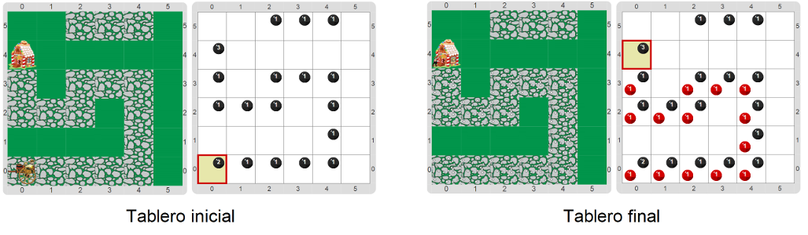

#Proyecto 4. Hansel y Gretel van a a la casa de la Bruja

Hansel y Gretel van en la carreta mágica hacia la casa de la Bruja y deben 
dejar miguitas de pan en el camino para poder volver, porque no saben qué 
forma ni qué longitud tiene el camino. 
Cada grupo de miguitas se representa con una bolita de color “`miguitas`”, 
una función que devuelve el color correspondiente. 
El lugar donde Hansel y Gretel se suben a la carreta se representa con 2 bolitas negras, 
cada sección del camino se representa con 1 bolita negra y la casa de la bruja se 
representa con 3 bolitas negras. 
En el tablero puede haber también bolitas negras que no pertenecen al camino, y 
que no serán tenidas en cuenta en la solución.

En el proyecto se provee también un procedimiento primitivo `Avanzar carreta` que 
se encarga de avanzar la carreta; completá el programa para que avance la carreta hasta 
la casa de la bruja sin olvidar ir dejando miguitas en el camino. 
Un posible tablero inicial y su correspondiente tablero final, con y sin vestimenta, 
se observan en las imágenes:
       

¡Acordate de empezar pensando una estrategia de solución, y viendo qué subtareas son 
necesarias para expresarla! 
Al finalizar, le docente va a proponer un análisis de las soluciones propuestas, así que 
pensá bien las partes de tu programa, y cómo se arman para proveer la solución final.

[Enunciado en PDF][PDF]

[PDF]: https://raw.githubusercontent.com/gobstones/curso-InPr-UNQ/master/Proyectos/8.Repetici%C3%B3n%20condicional/4.Hansel%20y%20Gretel%20van%20a%20a%20la%20casa%20de%20la%20Bruja/assets/resources/description.pdf "Enunciado de 'Hansel y Gretel van a a la casa de la Bruja' en PDF"
