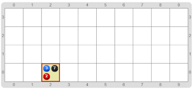
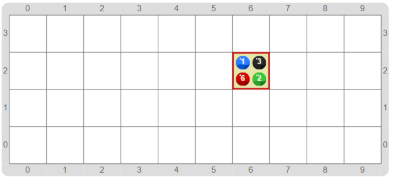

#Proyecto 2.2. ¿A qué distancia está el borde?

El propósito del programa en esta actividad es sencillo: hay que informar 
en la celda actual cuál es la distancia hasta cada uno de los 4 bordes: 
bolitas azules para el Norte, negras para el Este, verdes para el Sur y rojas para el Oeste. 
El desafío es hacerlo sin que el cabezal salga de la celda inicial. 
Te mostramos algunos tableros finales.

&nbsp;&nbsp;&nbsp;&nbsp;&nbsp;&nbsp;&nbsp;&nbsp;&nbsp;&nbsp;&nbsp;
&nbsp;&nbsp;&nbsp;&nbsp;&nbsp;&nbsp;&nbsp;&nbsp;&nbsp;&nbsp;&nbsp;
&nbsp;&nbsp;&nbsp;&nbsp;&nbsp;&nbsp;&nbsp;&nbsp;&nbsp;&nbsp;&nbsp;

Una buena idea es hacer un recorrido moviéndose hacia el borde, y acumulando la cantidad 
de pasos dados, como hicimos con Super Lucho en la actividad anterior. 
Pero si no podemos movernos, ¿cómo hacemos? 
Podríamos utilizar una función que informe la cantidad, por ejemplo `distanciaHastaElBorde(direcciónAMedir)`. 
Para eso, fijate en la caja de herramientas, que hay una forma nueva de funciones: las **funciones con procesamiento**. 
El truco es utilizar una característica de estas funciones: al ejecutar una función con procesamiento 
el cabezal _se imagina que se mueve_, pero no lo hace realmente, como si enviase a una copia fantasma de 
sí mismo, con la única excepción de que si explota la función, explota todo el programa. 
Experimentá con las funciones con procesamiento, y fijate cómo definir un recorrido dentro de una función. 
Acordate que la función debe retornar el valor pedido al terminar.

> **Nomenclatura**
>
> Las funciones que realizan acciones antes de devolver el valor se denominan **funciones con procesamiento**. 
> Pero como el propósito de una función es devolver un valor, ese procesamiento no es real, sino imaginario: 
> el que usa la función no lo ve, ni se entera de que existió, salvo que la función explote.

[Enunciado en PDF][PDF]

[PDF]: https://raw.githubusercontent.com/gobstones/curso-InPr-UNQ/master/Proyectos/9.Otras%20herramientas%20avanzadas/2.2.A%20qu%C3%A9%20distancia%20est%C3%A1%20el%20borde/assets/resources/description.pdf "Enunciado de '¿A qué distancia está el borde?' en PDF"
