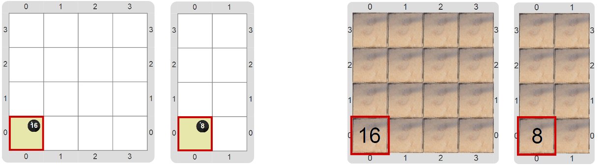

#Proyecto 3.1. Contar las baldosas

Construí un programa que cuente las baldosas que hay en el patio. 
El patio está representado por el tablero, y cada celda es una baldosa; 
el resultado de la cuenta hay que ponerlo en la celda de la esquina suroeste 
usando bolitas negras. 
Te mostramos algunos tableros finales, sin vestimenta y con ella:

El consejo es que utilices un recorrido por celdas, como el de 
_“Limpiemos imágenes”_, pero que le agregues un acumulador que vaya 
contando cuántas celdas visitaste. 
O sea, podés usar una función similar a `esLaÚltimaCelda` y un procedimiento 
similar a `PasarALaSiguienteCelda` de aquel programa; y la variable para acumular 
el resultado puede llamarse `cantidadDeBaldosasYaVistas`. 
¡Prestá atención a los casos de borde! 

Este recorrido puede ser el procesamiento de una función `cantidadDeBaldosas`, 
que se encargue de retornar ese número, que luego usás para poner las bolitas negras necesarias.

[Enunciado en PDF][PDF]

[PDF]: https://raw.githubusercontent.com/gobstones/curso-InPr-UNQ/master/Proyectos/9.Otras%20herramientas%20avanzadas/3.1.Contar%20las%20baldosas/assets/resources/description.pdf "Enunciado de 'Contar las baldosas' en PDF"
