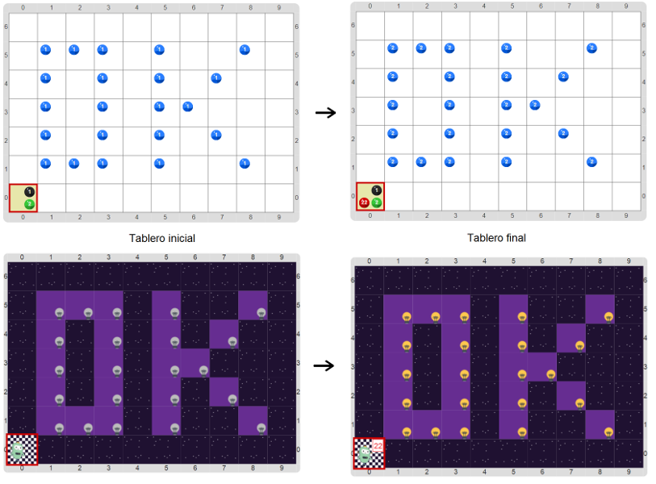

#Proyecto 3.3. Super Lucho, recargado

Construí un programa para que, una vez más, Lucho encienda todas las 
luces, pero esta vez también debe contar cuántas luces prendió. 
No sabemos qué tamaño tiene el tablero de luces, ni en qué lugares hay luces. 
Para informar cuántas luces prendió, Lucho deberá utilizar bolitas rojas en la 
esquina suroeste. 
Te mostramos un tablero inicial y su correspondiente tablero final.

¡No te olvides de usar todas las herramientas que aprendimos! 
En particular, no te olvides de representar a Lucho, y a los elementos del problema, 
y tampoco de armar las subtareas para el recorrido que prende las luces.

> **Un secreto**
> Te contamos un secreto de los programadores profesionales: siempre miran los programas 
> que ya hicieron para sacar ideas. 
> Es más: si alguna parte del código sirve, ¡la reutilizan!

[Enunciado en PDF][PDF]

[PDF]: https://raw.githubusercontent.com/gobstones/curso-InPr-UNQ/master/Proyectos/9.Otras%20herramientas%20avanzadas/3.3.Super%20Lucho,%20recargado/assets/resources/description.pdf "Enunciado de 'Super Lucho, recargado' en PDF"
