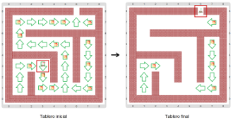
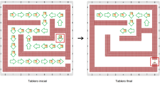

# Proyecto: Laberinto con queso

Una vez más el ratón está en el laberinto. 
Pero esta vez hay una diferencia: en algunos lugares del laberinto hay pedacitos de queso desperdigados. 
Completá el programa para que el ratón pueda salir del laberinto, como antes, pero comiéndose todo el 
queso que encuentra por el camino; los quesos que no están en el camino no los va a comer. 
Como otras veces, te mostramos algunos tableros iniciales y sus correspondientes tableros finales:

&nbsp;&nbsp;&nbsp;&nbsp;&nbsp;&nbsp;&nbsp;&nbsp;&nbsp;&nbsp;&nbsp;&nbsp;&nbsp;&nbsp;&nbsp;&nbsp;&nbsp;&nbsp;&nbsp;&nbsp;

&nbsp;&nbsp;&nbsp;&nbsp;&nbsp;&nbsp;&nbsp;&nbsp;&nbsp;&nbsp;&nbsp;&nbsp;&nbsp;&nbsp;&nbsp;&nbsp;&nbsp;&nbsp;&nbsp;&nbsp;

Te recomendamos que veas bien cómo funcionan los procedimientos y sensores primitivos.
En particular, hay que mirar bien el sensor para saber si hay queso, pues no funciona en todos lados.