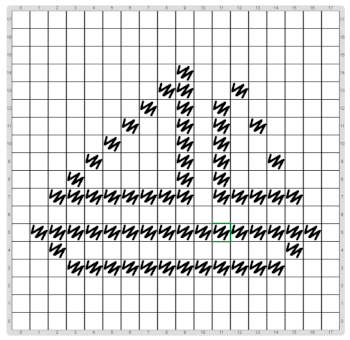

# Proyecto: Programar en cuadriculado: Velero

En este proyecto se expresa la misma idea de la actividad "Programar en cuadriculado", que hicimos sin computadoras.
El objetivo en este caso es dibujar un velero, como se muestra en la figura.

¡No te olvides de usar procedimientos para expresar las partes del problema, y lograr que tu programa sea legible!