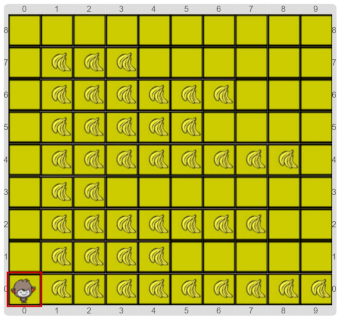

# Proyecto: El planeta de Nano (con parámetros)

Una vez más hay que lograr que Nano se coma todas las bananas.
El tablero inicial es siempre el mismo, o sea que la cantidad de bananas en cada fila es la 
misma en todas las ejecuciones.

La diferencia con la vez anterior es que esta vez te pedimos que uses un solo procedimiento para recorrer todas las filas.
¿Cómo lograr expresar que cada fila tiene una cantidad de bananas diferente en el _mismo_ procedimiento?