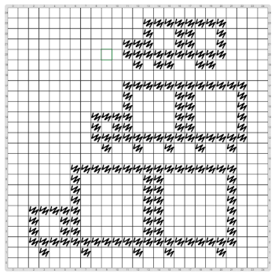

# Proyecto: Programar en cuadriculado: Camiones

En este proyecto se expresa la misma idea de la actividad "Programar en cuadriculado", que hicimos sin computadoras.
El objetivo en este caso es dibujar varios camiones, como se muestra en la figura.

¿Cómo lograr usar un único procedimiento de dibujar camiones?
Te puede ayudar observar que el acoplado del camión está formado por 2 cajas que son del doble del tamaño de la cabina.
Y que las ruedas siempre están a 1 lugar de distancia de los bordes de cada sección.
El código que ya viene comenzado expresa esta estrategia. 
¿Te atrevés a completarlo?

ATENCIÓN: la solución requiere unas cuantas cuentas. :(