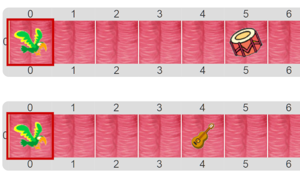

#Proyecto: La música del loro

En esta actividad, el programa debe ayudar al loro a llegar hasta el instrumento, y luego de llegar a él, 
debe iniciar el concierto. 
La pequeña dificultad es que no siempre aparece el mismo instrumento y no siempre aparecen en el mismo lugar. 

> **Diferentes sensores, para diferentes propósitos**
>
> Cada sensor evalúa diferentes condiciones. Más adelante veremos que podemos construir también nuestros propios sensores.
