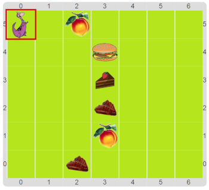
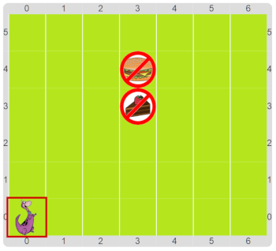

#Proyecto: Dino aprende a no comer chatarra

Al igual que en la actividad anterior, tenemos que ayudar a Dino a comer su cena. 
Pero ahora Dino está aprendiendo que es malo comer comida chatarra, y por lo tanto solo come 
la comida sana y rechaza la comida chatarra: elije bife y fruta pero rechaza hamburguesas y tortas. 
Al igual que antes, hay 6 filas con una comida en cada una, y no sabemos ni qué comida será ni a qué 
distancia está. Por eso en cada fila hay que ayudar a Dino a llegar hasta la comida, comer la comida 
si es sana y volver al inicio de la fila.

&nbsp;&nbsp;&nbsp;&nbsp;&nbsp;&nbsp;&nbsp;&nbsp;&nbsp;&nbsp;
&nbsp;&nbsp;&nbsp;&nbsp;&nbsp;&nbsp;&nbsp;&nbsp;&nbsp;&nbsp;
&nbsp;&nbsp;&nbsp;&nbsp;&nbsp;&nbsp;&nbsp;&nbsp;&nbsp;&nbsp;
&nbsp;&nbsp;&nbsp;&nbsp;&nbsp;&nbsp;&nbsp;&nbsp;&nbsp;&nbsp;

Lo interesante está en cómo construir la expresión que permite a Dino saber si llegó a la comida. 
¿No sería bueno poder definir un sensor que indique si hay comida? 
Buscá en la caja de herramientas, que seguro encontrás algo.

¡Y no te olvides de hacer que Dino rechace la comida que no come!

> **Funciones simples**
>
> Las funciones permiten nombrar expresiones complejas para expresar una idea (pregunta, dato, etc.), exactamente 
> igual que los procedimientos simples permiten nombrar grupos complejos de comandos para expresar una subtarea.

[Enunciado en PDF][PDF]

[PDF]: 
https://raw.githubusercontent.com/gobstones/laprogramacionysudidactica2/master/Proyectos/1.Expresiones%20y%20funciones/2.Dino%20aprende%20a%20no%20comer%20chatarra/assets/resources/description.pdf "Enunciado de 'Dino aprende a no comer chatarra' en PDF"
