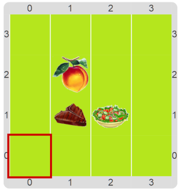
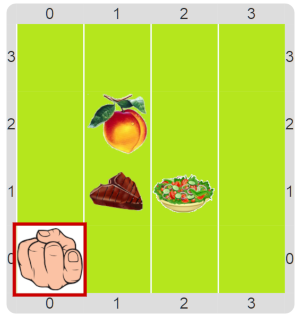

#Proyecto: Está lista la cena

En esta actividad ya está construido un programa para avisar cuando está lista la cena.
Pero hay un problema: el programa no está funcionando bien.
Sabemos que una cena está compuesta por un plato principal y un postre. 
El plato principal puede ser bife con ensalada o una hamburguesa con papas fritas (un GobCombo). 
El postre puede ser sencillamente una fruta o una porción de torta.
Si falta cualquiera de los elementos, o la combinación no es adecuada (por ejemplo falta la ensalada, 
o hay ensalada con hamburguesa), la cena no está lista.  

Por ejemplo, a continuación podés ver una cena lista en la primera imagen, y cómo debería ser el
resultado del programa al ejecutarlo en la segunda imagen.

&nbsp;&nbsp;&nbsp;&nbsp;&nbsp;&nbsp;&nbsp;&nbsp;&nbsp;
&nbsp;&nbsp;&nbsp;&nbsp;&nbsp;&nbsp;&nbsp;&nbsp;&nbsp;
&nbsp;&nbsp;&nbsp;&nbsp;&nbsp;&nbsp;&nbsp;&nbsp;&nbsp;
&nbsp;&nbsp;&nbsp;&nbsp;&nbsp;&nbsp;&nbsp;&nbsp;&nbsp;
&nbsp;&nbsp;&nbsp;&nbsp;&nbsp;&nbsp;&nbsp;&nbsp;&nbsp;

¿Funciona así el programa? Si no funciona así, tenés que encontrar dónde está el error, y corregirlo.

> **¿Cómo encontrar un error?**
>
> Las funciones que te presentamos tienen buenos nombres. Eso significa que leyendo el código, podrías descubrir
> fácilmente cuál es el error. ¡Probá hacerlo de esta forma!
> ¿Viste qué importante que es poner buenos nombres a tus procedimientos y funciones?
