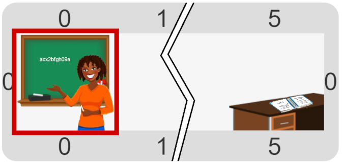

#Proyecto: Recuerden la contraseña

En esta actividad hay que construir un programa que permita que la docente publique la contraseña de la red, para que todos puedan
usarla.
La contraseña está anotada en un cuaderno en el fondo del salón, y la docente tiene que leerla, ir hasta el pizarrón y anotarla,
pero no puede sacar el cuaderno de su lugar.
¿Cómo va a hacer la docente para _recordar_ la contraseña?

> **¿Cómo recordar los valores mientras me muevo?**
>
> Debería haber alguna primitiva nueva y algún dato nuevo…
