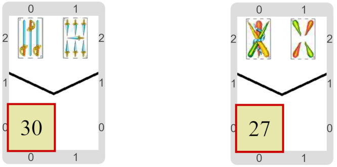

#Proyecto: ¿Cuánto envido?

Tenemos que calcular el valor de un envido simple.
O sea, tenemos 2 cartas, y sabemos que tienen el mismo palo y que no son figuras.
Y sabemos que el envido simplw se calcula sumando los valores de esas cartas, y luego sumándoles 20.
¿Qué información es necesaria?
¿Cómo uso variables para recordarla?

