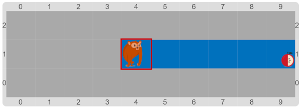
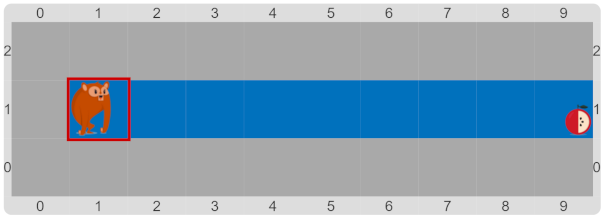

#Proyecto: El mono va y vuelve

Ahora la tarea del mono es un poco más fácil: tiene que ir hasta el final de la fila, traer la fruta que aparece ahí,
y _volver_ a su lugar de inicio.
El tema es que el inicio no está indicado…
¿Se te ocurre alguna manera de saber _cuántas_ celdas tiene que volver para atrás?
¡No te olvides de separar en procedimientos!
Capaz que alguno precisa un parámetro…

&nbsp;&nbsp;&nbsp;&nbsp;&nbsp;&nbsp;&nbsp;&nbsp;&nbsp;&nbsp;&nbsp;&nbsp;&nbsp;&nbsp;&nbsp;&nbsp;
&nbsp;&nbsp;&nbsp;&nbsp;&nbsp;&nbsp;&nbsp;&nbsp;&nbsp;&nbsp;&nbsp;&nbsp;&nbsp;&nbsp;&nbsp;&nbsp;

> **Pista**
>
> Los datos que se pueden calcular en una variable no son solamente para informar:
> también se pueden usar para otras tareas.
