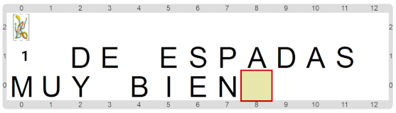
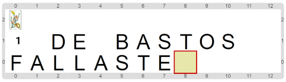

#Actividad 3. Descubrir la carta

En esta actividad tenés que descubrir cuál es la carta que la computadora eligió, y escribir el número y el palo de la misma.
Para eso, indagá entre las operaciones primitivas, para ver de qué disponés. Si lográs como resultado la primera de las imágenes
que aparecen a continuación, tu programa hizo lo que se esparaba; pero si obtenés uno como la segunda de ellas, entonces tenés
que ver qué hiciste mal...

> **El poder de las expresiones**
>
> Las expresiones sirven para mucho más que para hacer preguntas que se responden por sí o por no, 
> como en el caso de los sensores. Podemos obtener mucha información a través de expresiones.

[Enunciado en PDF][PDF]

[PDF]: 
https://raw.githubusercontent.com/gobstones/laprogramacionysudidactica2/master/Proyectos/1.Expresiones%20y%20funciones/3.Descubrir%20la%20carta/assets/resources/description.pdf "Enunciado de 'Descubrir la carta' en PDF"
