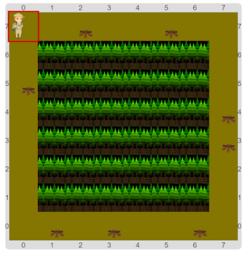

#Actividad 2.1. Prender las fogatas, parametrizado

El explorador está preparando el campamento para la llegada del grupo. Y para eso tiene que prender todas las fogatas.
La idea es construir un único procedimiento para encender lados, y que lo uses para cada uno de los 4 lados…

Acordate de mirar los tableros posibles, para entender cuáles son las variaciones. 
También acordate de usar procedimientos para las subtareas.
¿Pero cómo hacer para tener **un solo** procedimiento que sirva para los 4 lados?

> **Argumentos y parámetros**
>
> ¿Viste que los comandos y procedimientos primitivos esperan argumentos?
> ¿Habrá alguna manera de que al definir procedimiento propio se le pueda indicar que espere un argumento?
> La indagación es tu aliada.

[Enunciado en PDF][PDF]

[PDF]: 
https://raw.githubusercontent.com/gobstones/laprogramacionysudidactica2/master/Proyectos/2.Par%C3%A1metros%20y%20Entrada-Salida/2.1.Prender%20las%20fogatas%2C%20parametrizado/assets/resources/description.pdf "Enunciado de 'Prender las fogatas parametrizado' en PDF"
                                                                                        