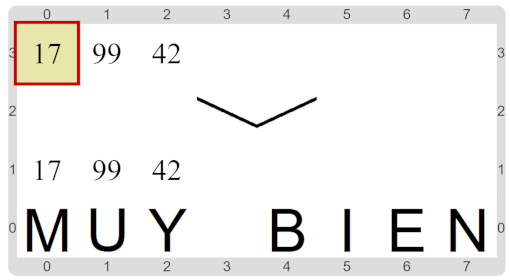

#Actividad 1. Descubrir la lista

En esta actividad aparece una lista de 3 números, oculta. 
El objetivo de la actividad es construir un programa que descubra cuáles son los números de la lista. 
Para eso hay muchas operaciones sobre la lista que podés usar. 
Indagá para descubrir cómo funcionan, y pensá cómo hacer para obtener cada uno de los elementos 
utilizando esas operaciones.
El escenario final te tiene que quedar, por ejemplo, de esta forma:

> **¿Cómo obtener los elementos?**
>
> Algunos de los elementos son muy fáciles de conocer. 
> Pero para otros tenés que pensar un poco más; pero todos se pueden obtener en los ejemplos que te mostramos.
> ¡No te rindas!
> Y no te olvides de dividir en subtareas para expresar los conceptos necesarios.

[Enunciado en PDF][PDF]

[PDF]: 
https://raw.githubusercontent.com/gobstones/laprogramacionysudidactica2/master/Proyectos/4.Introducci%C3%B3n%20a%20listas/1.Descubrir%20la%20lista/assets/resources/description.pdf "Enunciado de 'Descubrir la lista' en PDF"